# Roadmap — Balacopapo

> **Origem:** Fork/evolução própria em cima do Backspace (`TheZwiss/backspace` v1.11.0 / `2885a7d3`), mantendo compatibilidade para puxar correções de segurança do upstream quando houver.
> **Atualizado em:** 24/11/2026

---

## 1. Já Feito (Base pronta em `custom/all-fixes` e branches individuais)

Todas estas entregas já estão implementadas e validadas na base atual (`4441bfe`):

- [x] **Suspensão de áudio em inatividade** (`fix/audio-idle-suspend` · PR #494 / Issue #473) — libera o DAC/driver de áudio quando ocioso e trata estado `interrupted` no iOS.
- [x] **Layout de voz em tela cheia** (`fix/voice-fullscreen-layout` · PR #496) — vídeo edge-to-edge fundo preto, auto-hide sincronizado de overlays, faixa de membros sem sobreposição, blur automático e remoção de tooltip nativo.
- [x] **Ocultar participantes sem vídeo** (`feat/hide-non-video-participants` · PR #497 / Discussion #488) — toggle desktop e mobile com i18n completo.
- [x] **Áudio Opus configurável em hierarquia completa** (`feat/opus-audio-settings` · Issue #495) — política determinística *Instância → Espaço → Categoria → Canal → Usuário*, modo Voz vs. Música, Estéreo, telemetria ao vivo (`ConnectionInfoPopover`) e sincronização no `ready` payload.
- [x] **Soundboard completo** (`feat/soundboard` · Design Proposal) — pastas, busca, permissão `USE_SOUNDBOARD`, limites por instância/espaço, editor WAV no navegador com recorte + normalização Active-RMS + soft limiter, barramento de ganho ao vivo com curva quadrática e botão no rodapé mobile.
- [x] **Seletor rápido de status + fix da caixa de perfil** (`feat/status-picker` · Feature Request) — popover acessível a 1 clique no rodapé com opções Online/Ausente/Não Perturbe e timer de reversão automática.

---

## 2. Já Mapeado / Pendente (Backlog imediato)

Itens já identificados durante os testes e uso real:

- [x] **Recuperação de áudio pós-suspensão do PC (sleep/wake)** — monitor de gap de relógio + `visibilitychange` em `AudioManager.ts` que retoma `AudioContext` suspenso/interrompido, re-aplica `setSinkId` e reabre o microfone se a faixa encerrar.
- [x] **Zoom & Pan na stream focada** — scroll 1x–6x ancorado no ponteiro + arrastar para ler texto pequeno em compartilhamento de tela + pílula de reset (`StreamTile.tsx`).
- [ ] **Acompanhar upstream (`TheZwiss/backspace`)** — acompanhar PRs #494, #496, #497, Issue #495 e novas Issues/Proposals para reduzir manutenção no fork.

---

## 3. Roadmap do Balacopapo (O que falta fazer)

### Fase 0 — Identidade, Terminologia e Personalização
- [x] **Repositório e imagem Docker próprios (`balacopapo`)** — monorepo unificado (`packages/` + `clients/desktop` + `clients/android`), imagem `ghcr.io/richarddavid7/balacopapo`, releases multiplataforma (`release.yml`) e `TheZwiss/backspace` como `remote upstream` para puxar correções de segurança.
- [x] **Rebrand para Balacopapo** (nome, títulos, metadados PWA/Desktop/Android, locales nos 5 idiomas e README do monorepo; ícones personalizados podem ser substituídos depois).
- [x] **Suporte a Deep Links / "Abrir com Balacopapo"** — esquema customizado `balacopapo://` (Tauri `deep-link`, PWA `protocol_handlers` `web+balacopapo`, Android `AndroidManifest.xml` intent-filter + parser compartilhado `deepLink.ts`):
  - Botão **"Abrir com Balacopapo"** na página de convite (`/join/:inviteCode`) nos 5 idiomas.
  - Rota de callback segura `/auth/callback` pronta para o **OIDC** (`balacopapo://auth/callback`).
- [x] **Ajuste de terminologia:** trocar *Espaço* → **Grupo** e *Grupo* (DM em grupo) → **Grupo Direto** (aplicado nos locales `pt` do Web e `values-pt-rBR` do Android).
- [x] **Trocar nome de usuário** (baseado em `users.id` imutável para preservar menções `@`, histórico e futuro vínculo OIDC; validação de formato/unicidade em `PATCH /api/users/@me`, broadcast `user_updated` em tempo real e campo editável nas Configurações da Conta nos 5 idiomas).

### Fase 1 — Estabilidade de Voz, Vídeo e Rede (Prioridade Alta) *(Concluída)*
- [x] **Buffer contra perda de pacote / jitter** — `jitterBufferTarget` + `playoutDelayHint` aplicados nos `RTCRtpReceiver` de áudio (`jitterBufferMs` configurável ao vivo no `VoicePanel`: Auto / 40 / 80 / 120 ms) + Opus RED/FEC.
- [x] **Bitrate dinâmico inteligente (orçamento de banda) & fim das quedas para 320p:**
  - `degradationPreference: 'maintain-resolution'` + `scaleResolutionDownBy = 1.0` no `screenShare.ts` para impedir quedas bruscas para 320p em picos de congestão.
  - Campo configurável **Orçamento total de upload (Mbps)** nas Configurações da Instância (`0038_stream_bandwidth_budget.sql` + `StreamingPanel`) ajustando o teto dinamicamente via `RTCRtpSender.setParameters()` conforme entram/saem espectadores e streams (com piso de 1,5 Mbps).
- [x] **Melhorar consistência geral** — após reconexão LiveKit (`ConnectionState.Connected`), re-sincroniza automaticamente `broadcastVoiceStatus()`, `AudioManager.recoverFromWake()` (`AudioContext` + `setSinkId`) e `jitterBufferMs` em todos os receivers de áudio.
- [x] **Teste de microfone (loopback local)** — botão nas configurações de voz (`AudioInputSection` + `AudioManager.startMicLoopback`) para ouvir a própria voz já passando por RNNoise, ganho e AEC.

### Fase 2 — Malha P2P Híbrida (com Failover na Instância) *(Concluída)*
- [x] **2A · P2P para arquivos + Indicador P2P** — sinalização WebSocket autenticada (`p2p_signal`), motor `P2PMeshManager` (WebRTC DataChannel com chunks de 16 KB + backpressure), **consentimento obrigatório do destinatário (Aceitar / Recusar antes de transferir qualquer byte)** e envio direto na **Conversa Direta (DM)** com bandeja flutuante `P2PTransferTray`.
- [x] **2B · Mapa da malha P2P com latência** — modal `P2PMeshModal` com grafo visual SVG mostrando o RTT direto (ping/pong a cada 3s) entre você e cada participante, tipo de rota (`LAN`/`NAT`/`Relay`) e latência até a instância.
- [x] **2C · P2P híbrido para chamadas de voz (com failover duplo):**
  1. Conecta normalmente via instância (sinalização + SFU).
  2. Anexa a track de áudio do microfone no `RTCPeerConnection` direto (`P2PMeshManager.ts`) e troca o RTT até o servidor via DataChannel (`srvRtt`) para calcular o caminho completo `meuRttServidor + rttServidorDoPar`.
  3. Prioriza o áudio P2P direto (`GlobalAudioRenderer.tsx`) com histerese (`-10 ms` para entrar, `+15 ms` para voltar), eliminando áudio duplicado.
  4. **Failover duplo (Sobrevivência):** se o servidor/LiveKit cair, ativa o **Modo Sobrevivência P2P** mantendo as conexões diretas já estabelecidas falando sem interrupção; se a rota P2P degradar enquanto o servidor está online, volta automaticamente para o LiveKit.

### Fase 3 — Administração, Retenção de Arquivos e Segurança *(Concluída)*
- [x] **OIDC (SSO)** — login integrado com provedores OpenID Connect (Authentik, Keycloak, Pocket ID, Authelia, etc.) configurado via variáveis de ambiente Docker (fora do banco), migração `0040_oidc_links.sql` (`(issuer, sub) -> users.id`), sync de foto de perfil (`OIDC_SYNC_AVATAR`), grupos de administradores (`OIDC_ADMIN_GROUPS`), painel **OIDC** nas Configurações da Instância para vincular usuários existentes (manualmente por `sub` ou via link de vínculo de 1 clique), e callback web/deep link (`balacopapo://auth/callback`).
- [x] **Ban por IP + ciclo automático + integração OPNsense/Nginx** — migração `0039_ip_bans.sql`, expiração automática em dias (`durationDays` / `expiresAt`), auto-ban de evasão se uma conta banida tentar entrar de um novo IP, painel **Ban IP** nas Configurações da Instância e feed `GET /api/admin/ip-bans/feed?format=opnsense|nginx` (compatível nativamente com Firewall Alias `URL Table (IPs)` do OPNsense e `deny` do Nginx).
- [x] **Retenção de arquivos no chat (controlada pela instância):**
  - Migração `0041_file_retention.sql` (`spaces.allow_file_retention` e `spaces.file_retention_enabled`).
  - A **instância autoriza ou revoga quais grupos têm permissão** na aba Armazenamento (`StoragePanel` → `GET/PATCH /api/admin/spaces/:spaceId/retention`).
  - Apenas nos grupos autorizados pela instância, o grupo pode ativar **Retenção de Arquivos no Chat** (`OverviewPanel`), protegendo os anexos do grupo em `cleanupOldMedia()`.

### Fase 4 — Interação em Call, Presença e Acessibilidade
- [x] **Clicar e apontar na stream** — marcação visual temporária (coordenadas normalizadas X/Y via LiveKit DataChannel em `streamPointerProtocol.ts` + `streamPointerStore.ts` + `StreamTile.tsx`) com `Shift+clique` (ou modo Apontar) no desktop e **botão de mira arrastável deslocada 64px acima do dedo no mobile** (dispara ao soltar), acompanhando zoom/pan e `object-contain`.
- [ ] **Prévia de câmera ao clicar no botão da câmera** — abrir uma prévia local da webcam (com seletor de dispositivo e opção de confirmar/cancelar) antes de transmitir o vídeo para os demais participantes da call.
- [ ] **Indicar qual jogo está jogando** — permitir escolher/indicar manualmente (ou detectar no desktop) qual jogo aparece no seu perfil/presença *(acompanhar/integrar PR upstream `TheZwiss/backspace#482`)*.
- [ ] **Modo leigo / acessível no Android (mobile)** — layout simplificado com botões grandes, alto contraste e fluxo direto pensado para idosos e usuários iniciantes.

### Fase 5 — Desktop Nativo: Sobreposição (Overlay) e Áudio da Janela
- [ ] **Sobreposição (Overlay in-game):**
  - **Ícone quando alguém fala** (indicador flutuante sobre o jogo mostrando quem está falando no momento).
  - **Aviso quando alguém entra** (notificação discreta no overlay quando alguém entra/sai da call).
- [x] **Áudio apenas da janela** — seletor **Apenas da janela / Sistema inteiro** (`audioScope`) em `StreamQualityControls` + `windowAudio: 'window'` (Windows 11 WASAPI Process Loopback / Chromium 130+) + isolamento PipeWire por aplicativo (`buildIncludeNodes` com fallback automático) no Linux (`packages/desktop/src/systemAudio.ts`).
- [x] **Atalhos globais de teclado no Desktop** — *Mute*, *Deafen*, *Push-to-Talk*, silenciar Soundboard e atalhos rápidos individuais para qualquer som do Soundboard (`keybindStore.ts` + `useKeybinds.ts` + `soundboardPlay.ts` + `KeybindsPanel.tsx`) funcionando dentro de jogos sem precisar dar Alt+Tab.

### Fase 6 — Balacopapo Utilidades: Ponte de Voz com Discord (Ponto A ↔ Ponto B)
- [ ] **App / serviço companheiro "Balacopapo Utilidades"** (base compartilhada que conecta como participante de áudio nas salas LiveKit, podendo rodar no Windows ou como container Docker).
- [ ] **Ponte de áudio Balacopapo ↔ Discord** — conecta um canal de voz do Balacopapo (Ponto A) a um canal de voz do Discord (Ponto B) em tempo real, escolhendo os dois canais direto no Balacopapo Utilidades.

### Fase 7 — Balacopapo Utilidades: Bot de Música / Rádio
- [x] **API oficial do Bot de Música & Mini-player no Balacopapo (`packages/server/src/routes/music.ts` + `MusicMiniPlayer.tsx`):**
  - **Mini-player acoplado acima do status da call (`VoiceControls`)** com faixa atual, play/pause, volume, fila, adição de URLs e **Vote-Skip configurável por porcentagem (`25% / 50% / 60% / 75% / 100%`)** calculado dinamicamente sobre o número de ouvintes na call.
  - **Broadcast em tempo real** via WebSocket (`music_state_updated`) para todos os usuários do grupo.
  - **Chaves de API por Grupo (`Configurações do Grupo → API & Apps`):**
    - Cada grupo pode criar, listar e revogar múltiplas chaves próprias (`bp_...`, salvas com hash SHA-256 em `0043_space_api_keys.sql`) com escopos (`music`, `voice_bridge`), permitindo conectar o **Balacopapo Utilidades** ou qualquer app/bot próprio com isolamento estrito ao grupo.
  - **Contrato de API para o app companheiro (`Balacopapo Utilidades` ou apps de terceiros):**
    - Autenticação por header `X-Api-Key: bp_...` (ou `X-Music-Bot-Key` / `Authorization: Bearer bp_...`; mantém fallback opcional para `MUSIC_BOT_API_KEY` global).
    - `GET /api/spaces/bot/info` — descobre automaticamente o nome/ID do grupo, escopos da chave e lista de canais de voz disponíveis.
    - `POST /api/spaces/bot/:channelId/livekit-token` — emite token LiveKit para apps do grupo (suporta escopo `music` e `voice_bridge` com `canSubscribe: true`).
    - `POST /api/music/bot/:channelId/livekit-token` — emite token LiveKit dedicado para o bot de música publicar áudio na sala de voz do canal.
    - `GET /api/music/bot/:channelId/commands` — consome a fila de comandos emitidos pelos usuários (adicionar faixa, pausar, retomar, pular por vote-skip/forçado, parar, volume, loop, remover/limpar fila).
    - `POST /api/music/bot/:channelId/state` — reporta o estado real de reprodução (`status`, `currentTrack`, `positionSec`, `queue`, `volume`, `botConnected`) e sincroniza todos os clientes via WebSocket.
    - Endpoints de usuário (JWT normal): `GET /api/channels/:channelId/music`, `POST .../queue`, `POST .../vote-skip`, `POST .../control`, `PATCH .../settings`.
- [ ] **App companheiro "Balacopapo Utilidades" (Worker de Áudio):**
  - **Links do YouTube com `yt-dlp` + cache local** (baixa e guarda os áudios em cache para tocar sem engasgos e reaproveitar).
  - **Integração com Navidrome** (API Subsonic/OpenSubsonic para puxar sua biblioteca e playlists direto do servidor).
  - **Suporte a DLNA / UPnP** (descobrir e tocar faixas de servidores de mídia na rede local).

### Fase 8 — Controle Remoto, Personalização e Idiomas *(último)*
- [ ] **Controlar outro PC** — acesso remoto seguro (mouse e teclado) via app desktop nativo, com permissão explícita do dono da tela e revogação instantânea a qualquer momento.
- [ ] **Temas de interface** — sistema de temas sobre os tokens CSS do Aether Drift + seletor nas configurações.
- [x] **Preferências regionais independentes do idioma** — controles em Configurações → Aparência (`LanguageSection.tsx` + `regionalStore.ts` + `formatters.ts`) para formato de hora (**Automático / 24h / 12h**), formato de data (**Automático / DD/MM/AAAA / MM/DD/AAAA / AAAA-MM-DD**) e separador numérico (**Automático / 1.234,56 / 1,234.56**) com pré-visualização ao vivo, sem ficar preso ao idioma escolhido.
- [ ] **Idiomas adicionais & revisão final de traduções** — adicionar **Espanhol (`es`)** e fazer a revisão completa de **Alemão (`de`)**, **Russo (`ru`)** e **Chinês (`zh`)** ao final das entregas (durante o desenvolvimento ativo o foco fica em **Português (`pt`)** e **Inglês (`en`)**).

---

## Ordem de Execução

```mermaid
flowchart LR
    F0["Fase 0: Rebrand + Deep Links + Temas"] --> F1["Fase 1: Buffer + Bitrate Dinâmico + 320p"]
    F1 --> F2["Fase 2: P2P Arquivos → Mapa → P2P Call"]
    F2 --> F3["Fase 3: OIDC + Ban IP + Retenção"]
    F3 --> F4["Fase 4: Apontar + Jogos + Modo Leigo"]
    F4 --> F5["Fase 5: Overlay + Áudio da Janela"]
    F5 --> F6["Fase 6: Utilidades — Ponte Discord"]
    F6 --> F7["Fase 7: Utilidades — Música/Rádio"]
    F7 --> F8["Fase 8: Controlar Outro PC"]
```

