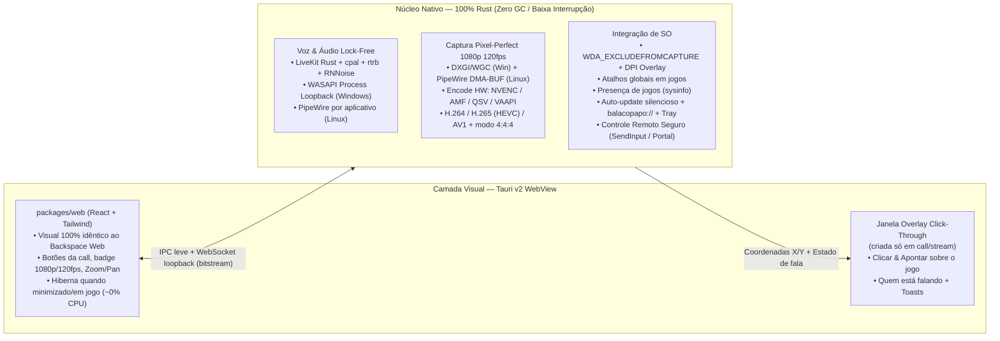

# Arquitetura Oficial — Balacopapo Desktop (**Tauri v2 Híbrido**)

> **Decisão arquitetural consolidada em 27/11/2026** após testes reais em Windows + Linux com `Iced 0.13` puro e análise de limitações de navegador.
> **Princípio central:** *Dividir e Conquistar* — um único executável nativo onde a **UI oficial do `packages/web`** cuida da interface visual (100% fiel ao Backspace Web) e o **núcleo 100% Rust** cuida de tudo que exige baixa interrupção de CPU, acesso ao SO, áudio isolado por janela e captura de tela pixel-perfect.

---

## 1. Metas & Orçamento de Recursos ("PC Calculadora de 1 Real")

| Métrica | Alvo | Como garantimos |
|---|---|---|
| **RAM (Chat parado)** | **~140 – 210 MB** | WebView nativa do SO (WebView2 no Win / WebKitGTK no Linux — zero Electron/Chromium embutido). |
| **RAM (Call + Overlay)** | **~210 – 290 MB** | Janela de Overlay criada **apenas** em call/stream e destruída ao sair (`0 MB` fora de call). |
| **RAM (Call + Stream 1080p120)** | **< 400 MB** | Captura e encode HW no Rust sem copiar frames RGBA crus pelo IPC. |
| **CPU em jogo (segundo plano)** | **~0% no WebView / ~1–3% em stream HW** | WebView pausa animações/timers quando minimizado/sem foco (`visibilitychange`); motor de áudio/captura/atalhos em Rust puro (**zero Garbage Collector**). |
| **Instalador** | **~10 – 18 MB** | Binário único Rust + assets estáticos do `packages/web` (Inno Setup / NSIS no Win, `.tar.gz`/`.AppImage` no Linux). |

---

## 2. Diagrama de Arquitetura (1 Executável, 2 Camadas)

---

## 3. As 5 Pontas Técnicas Amarradas no Design

1. **Conexão única ao LiveKit (sem conflito JS vs Rust):**
   - **Etapa 1:** `packages/web` mantém a sessão LiveKit normal enquanto o Rust entrega os recursos de SO (Overlay de Apontar, Atalhos Globais, Presença de Jogos, Auto-update, `balacopapo://`, Bandeja) e a ponte de **áudio isolado por janela (WASAPI / PipeWire)**.
   - **Etapa 2:** `DesktopMediaBridge` no `packages/web` — quando rodando dentro do Tauri (`window.__TAURI__`), o React delega voz e transmissão de tela para o **LiveKit em Rust** (1 única sessão por usuário, eliminando também qualquer limitação do WebKitGTK no Linux).

2. **Vídeo 1080p 120fps @ até 150 Mbps sem gargalo no WebView:**
   - **Envio:** Rust captura direto da VRAM (DXGI/WGC ou PipeWire DMA-BUF), encoda no chip de hardware da GPU (NVENC/AMF/QSV/VAAPI) e transmite direto pela rede — o vídeo enviado **nunca atravessa o WebView**.
   - **Recebimento:** Rust entrega apenas o **bitstream comprimido** (~18,7 MB/s a 150 Mbps, trivial em loopback local) para a GPU decodificar via `WebCodecs VideoDecoder` no `<canvas>` do `packages/web` (ou decode HW nativo), preservando 100% das sobreposições de UI (botões da chamada, badge de resolução/FPS, zoom 1x–6x, pan e apontar).
   - **Codecs:** prioridade em **H.264** (decodifica em hardware até em PCs antigos), **H.265 / HEVC** (qualidade superior e `4:4:4`) e **AV1**; **VP9** mantido apenas como opção secundária de compatibilidade (por falta de encoder HW na maioria das GPUs domésticas a 120fps).

3. **Perfis de Nitidez (`4:4:4` vs compatibilidade universal):**
   - **Padrão Alta Nitidez (`4:2:0` nativo sem downscale + `maintain-resolution` + encode HW):** compatível com Desktop, Navegador e Android.
   - **Modo Pixel-Perfect (`4:4:4` em H.264/H.265):** elimina o borrado de texto/HUD para sessões Desktop ↔ Desktop.

4. **Áudio Isolado por Janela / Processo (sem eco da call):**
   - **Windows 10 (20348+) / Windows 11:** `ActivateAudioInterfaceAsync` + `AUDIOCLIENT_PROCESS_LOOPBACK_PARAMS`:
     - *Apenas a janela/jogo:* `PROCESS_LOOPBACK_MODE_INCLUDE_TARGET_PROCESS_TREE` (captura o jogo + sub-processos/launcher, zero Spotify/notificações/call).
     - *Sistema inteiro (sem eco):* `PROCESS_LOOPBACK_MODE_EXCLUDE_TARGET_PROCESS_TREE` excluindo o PID do próprio Balacopapo.
   - **Linux (Fedora / CachyOS):** captura direta no nó PipeWire do `application.process.id` / `node.name` (inclusive Wine/Proton/Steam) ou exclusão do nó do Balacopapo.

5. **Sobreposições (Overlay In-Game + Clicar e Apontar) sem problemas:**
   - **Anti-duplicação na stream:** no Windows, a janela de Overlay recebe `SetWindowDisplayAffinity(hwnd, WDA_EXCLUDEFROMCAPTURE)` — o dono da tela vê o ponteiro e quem está falando sobre o jogo, mas a captura de tela ignora o Overlay. No Linux PipeWire, ao capturar a janela do jogo, o Overlay já fica fora da captura.
   - **Click-through real sem roubar foco:** `WS_EX_TRANSPARENT | WS_EX_NOACTIVATE | WS_EX_TOPMOST` (Win) + `ignore_cursor_events(true)` (Tauri v2). Funciona em *Borderless Fullscreen* e *Janela*, **sem injeção de DLL** (zero risco de Anti-Cheat).
   - **Precisão multi-monitor / DPI:** coordenadas normalizadas `(0..1)` mapeadas pelo retângulo físico real da janela/monitor compartilhado (`GetWindowRect` + escala DPI).
   - **Linux Wayland / WebKitGTK:** detecção automática de NVIDIA para fallback seguro de DMA-BUF no WebKitGTK + `wlr-layer-shell` para posicionamento do Overlay em Wayland (KDE/Hyprland/Sway) com fallback limpo no GNOME.

---

## 4. Plano de Execução em 4 Etapas

- **Etapa 1 — Base Tauri v2 + UI 100% Backspace Web + Integração de SO:**
  - Trocar a camada visual `Iced` por **Tauri v2** carregando a instância conectada (`packages/web`) com tela leve de seleção de instância.
  - Reaproveitar os módulos Rust já prontos (`updater.rs`, `autostart.rs`, `protocol.rs`, `notifications.rs`, `activity.rs`, `keybinds.rs`, `remote_control.rs`, `permissions.rs`).
  - Bandeja do sistema (System Tray), pausa em segundo plano (`visibilitychange`) e CI atualizado (Windows Inno Setup + Linux `.tar.gz`/`.AppImage`).
- **Etapa 2 — Áudio Isolado por Janela (WASAPI Process Loopback + PipeWire) & Overlay In-Game:**
  - Implementar captura WASAPI Process Loopback (Windows) e PipeWire por aplicativo (Linux) integrados à seleção de tela do `packages/web`.
  - Janela Overlay transparente *click-through* com `WDA_EXCLUDEFROMCAPTURE` + 3 camadas: **Clicar & Apontar** (com compensação de DPI/multi-monitor), **Quem está falando** e **Toasts**.
- **Etapa 3 — Captura & Transmissão Pixel-Perfect 1080p 120fps (Rust + Encode HW):**
  - Captura zero-copy DXGI/WGC (Windows) + PipeWire DMA-BUF (Linux).
  - Encode por hardware NVENC / AMF / QuickSync / VAAPI (H.264 / H.265 / AV1 até 150 Mbps + opção `4:4:4`) + `DesktopMediaBridge` para unificar LiveKit no Rust.
- **Etapa 4 — Atalhos Globais em Jogos, Presença de Jogos e Controle Remoto Seguro:**
  - Conectar `keybinds.rs`, `activity.rs` (`sysinfo`) e `remote_control.rs` (`SendInput` / `xdg-desktop-portal` com consentimento explícito e pânico `Ctrl+Alt+Esc`) direto na UI do `packages/web`.
