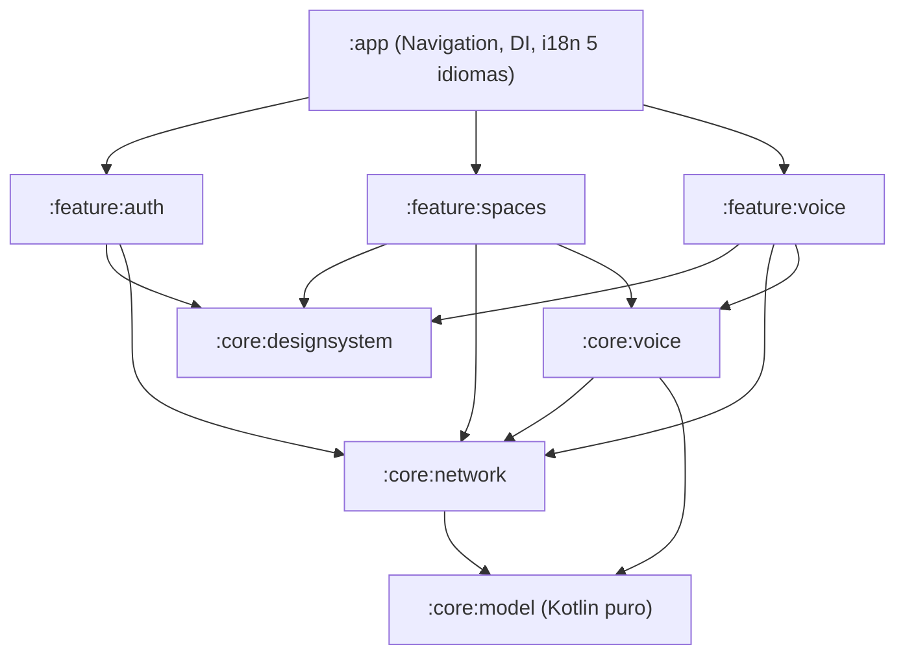

# Arquitetura Modular — Backspace Android

## Visão Geral (Mumble-grade Voice + Clean Modularity)

---

## Pilares de Eficiência Estilo Mumble

1. **Áudio 100% Nativo (`:core:voice`):**
   - `livekit-android` usa a pilha WebRTC C++ compilada para ARM64/ARMv7 com AAudio/OpenSL ES.
   - `AudioSwitch` / `AudioManager` em `MODE_IN_COMMUNICATION` com troca automática e manual entre **Bluetooth Headset (SCO/LE Audio)**, **Viva-voz**, **Fone com fio** e **Auricular**.
   - AEC, Noise Suppression e AGC acelerados por hardware do Android.

2. **Persistência em Background (`VoiceForegroundService`):**
   - `ForegroundService` do tipo `microphone|mediaPlayback` mantém a conexão de voz viva com a tela desligada ou durante jogos pesados.
   - Notificação persistente com ações nativas (**Mutar**, **Ensurdecer**, **Desconectar**) via `PendingIntent` + `BroadcastReceiver` sem precisar abrir a Activity.

3. **Suspensão de Áudio em Inatividade (paridade PR #494):**
   - Quando o usuário está silenciado ou sozinho em canal vazio por período configurável, libera captura ativa de microfone e reduz overhead de CPU/bateria, retomando instantaneamente ao desmutar ou quando alguém entra.

4. **Opus Adaptativo + Telemetria Precisa (paridade `feat/opus-audio-settings`):**
   - `AudioPolicyResolver` em `:core:model` aplica exatamente a mesma matriz `Instância → Espaço → Categoria → Canal → Usuário` do `@backspace/web`.
   - Reage em tempo real a `space_updated` / `category_updated` / `channel_updated` via WebSocket.
   - Telemetria lê `PeerConnection.getStats()` a cada 2s (ping RTT, jitter, perda de pacotes, bitrate, codec e Mono/Estéreo real via `sprop-stereo=1`).

---

## Como Evoluir (v0.2 e v0.3)
Para adicionar uma nova feature (ex.: `:feature:soundboard` ou `:feature:chat`):
1. Criar a pasta `feature/<nome>/` com `build.gradle.kts` + `MODULE.md`.
2. Registrar `include(":feature:<nome>")` em `settings.gradle.kts`.
3. Adicionar DTOs/eventos em `:core:model` e `:core:network`.
4. Conectar a rota no `NavHost` de `:app`.
Zero acoplamento cruzado entre features!
