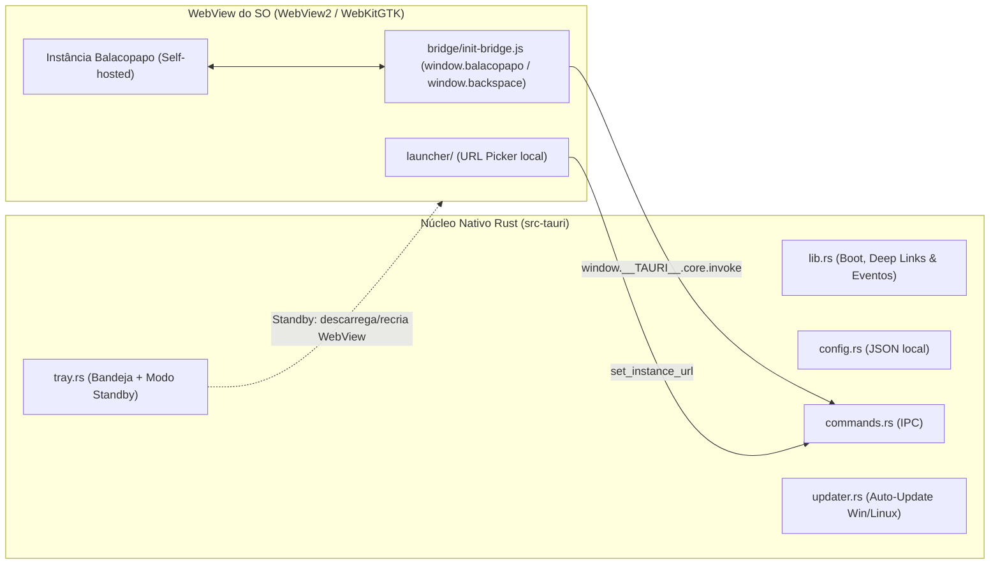

# Arquitetura — Balacopapo Desktop

Cliente desktop nativo leve para o **Balacopapo** (Tauri v2 + Rust), gerando instaladores **Windows (`.exe`/`.msi`)** e **Linux (`.AppImage`/`.deb`)** a partir da mesma base de código.

---

## 1. Visão Geral



---

## 2. Alinhamento com o Roadmap do Balacopapo (`../../ROADMAP.md`)

| Fase do Roadmap | O que o Desktop Nativo entrega | Módulo Rust | Status |
| :--- | :--- | :--- | :---: |
| **Fase 0 · Rebrand & Deep Links** | Rebrand Balacopapo + esquema `balacopapo://` (convites + callback OIDC `balacopapo://auth/callback`) com fila de cold-start e single-instance | `lib.rs`, `tray.rs`, `tauri.conf.json` | **Pronto** |
| **Base Leve + Auto-Update** | Tauri v2 (sem Electron), Modo Standby na bandeja (~10–15 MB), auto-update Win/Linux + CI GitHub Actions | `tray.rs`, `updater.rs`, `release.yml` | **Pronto** |
| **Fase 4 · Presença de Jogos** | Scanner leve de processos/jogos rodando no PC | `activity.rs` *(próximo)* | Planejado |
| **Fase 5 · Overlay & Áudio da Janela** | Overlay in-game (quem fala + entrada/saída), captura isolada de áudio da janela (WASAPI Application Loopback), atalhos globais (Mute, Deafen, PTT, Soundboard) | `overlay.rs`, `window_audio.rs`, `keybinds.rs` | Planejado |
| **Modo Mumble Real (Voz Nativa)** | Motor LiveKit + `cpal` + Opus nativo em Rust para hibernar a WebView **mesmo em chamada** (~15–25 MB RAM) | `voice.rs` | Planejado |
| **Fase 8 · Controle Remoto** | Input seguro (mouse/teclado) com permissão explícita e revogação instantânea | `remote_control.rs` | Planejado |

---

## 3. Paridade do Contrato IPC (`window.balacopapo` / `window.backspace`)

| Grupo | Métodos | Status |
| :--- | :--- | :---: |
| **Plataforma & Janela** | `platform`, `minimize`, `maximize`, `close`, `onWindowFocusChange` | Implementado |
| **Instância & Deep Links** | `getInstanceUrl`, `setInstanceUrl`, `clearInstanceUrl`, `onDeepLink` (`balacopapo://`) | Implementado |
| **Notificações & Badge** | `showNotification`, `onNotificationClick`, `setBadgeCount` | Implementado |
| **Auto-Update** | `getVersion`, `getUpdateStatus`, `onUpdateStatusChanged`, `checkForUpdates`, `installUpdate`, `dismissUpdate`, `openReleasePage`, `isSandboxed`, canais legados | Implementado (`tauri-plugin-updater`) |
| **Auto-Launch & Idioma** | `getAutoLaunchSettings`, `setAutoLaunchSettings`, `setLanguage` | Implementado (`tauri-plugin-autostart`) |
| **Recovery & Rotas** | `rendererReady` (descarrega deep link pendente), `getRecoveryState`, `onRecoveryStateChanged`, `recoveryAction`, `setConnectedOrigins`, `onOpenInternalRoute` | Implementado |
| **Extensões Nativas** | `window.balacopapoNative.getStandbyMode`, `setStandbyMode`, `hibernateNow` | Implementado |
| **Screen Share** | `getScreenSharePickerMode`, `getSystemAudioCapability`, etc. | Fallback nativo WebView (`pickerMode: 'native'`) |
| **Keybinds & Activity** | `syncKeybinds`, `onKeybindAction`, `getCurrentActivity`, `onActivityDetected` | Stubs seguros (Fases 4/5) |

---

## 4. Configuração do Auto-Updater (GitHub Releases)

1. Gere o par de chaves de assinatura uma única vez:
   ```bash
   cargo tauri signer generate -w ~/.tauri/balacopapo-desktop.key
   ```
2. Cole a **chave pública** em `src-tauri/tauri.conf.json` → `plugins.updater.pubkey` e confirme a URL do repositório em `plugins.updater.endpoints`.
3. Configure os secrets no repositório GitHub:
   - `TAURI_SIGNING_PRIVATE_KEY`
   - `TAURI_SIGNING_PRIVATE_KEY_PASSWORD` (se houver)
4. Publique uma tag `v0.1.0` (ou execute o workflow **Release** manualmente): o GitHub Actions compila Windows + Linux e gera o `latest.json` automaticamente.
