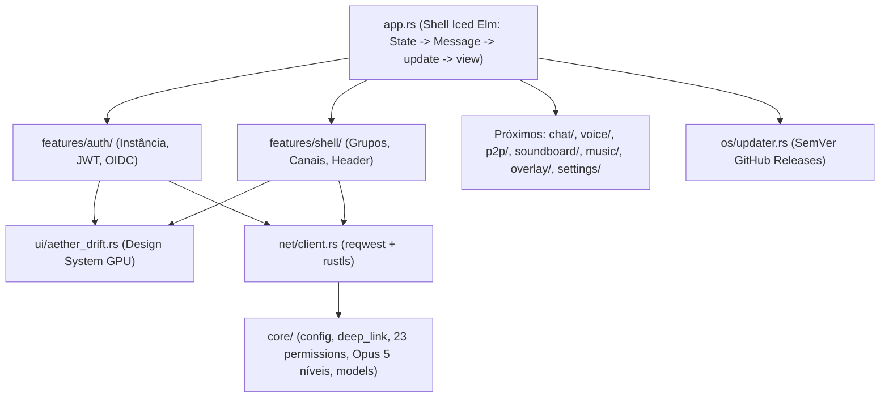

# Arquitetura — Balacopapo Desktop (100% Rust Nativo, Zero WebView)

Cliente desktop nativo de processo único construído com **Rust + `Iced` + `wgpu`**, projetado para **mínima interrupção de CPU/GPU em jogos** (zero queda de 1% low FPS, zero GC pauses, zero `msedgewebview2.exe`).

---

## 1. Zero-Stutter Budget (Metas de Eficiência Real)

Medido somando **toda a árvore de processos do SO**:

| Cenário | Meta RAM Real | Meta CPU / GPU em Jogos |
| :--- | :---: | :--- |
| Em call minimizado na bandeja | **~25–45 MB** | **< 0.5% CPU**, **0% GPU** (0 draw calls) |
| Janela aberta (Chat + Grupos + Mini-Player) | **~60–95 MB** | **0% GPU quando parada** (renderização sob demanda) |
| Assistindo / transmitindo 1080p60 (Hardware) | **~110–150 MB** | Decodificação/captura em hardware (NVDEC/D3D11VA/VAAPI) |
| Overlay In-Game transparente click-through | **+2–4 MB** | Redesenha só em evento de fala/toast/pointer |

---

## 2. Diagrama Modular

---

## 3. Marcos de Evolução

- [x] **Marco 1 — Fundação 100% Nativa (`Iced` + `wgpu`):** Design System Aether Drift, Auth JWT + OIDC (`balacopapo://`), 23 `PermissionBits`, política Opus 5 níveis, SemVer Updater, script guardião `check-desktop-parity.mjs`, CI + Release Windows/Linux.
- [x] **Marco 2 — Grupos, Categorias, Seletor de Status & Chat ao Vivo:** WebSocket resiliente (`tokio-tungstenite` + `rustls`, reconexão exponencial, heartbeat 15s sem acordar UI), histórico paginado (`before=<id>`), envio/exclusão em tempo real, agrupamento por autor, badges de não lidas, filtro local e seletor rápido de status.
- [x] **Marco 3 — Motor de Voz Nível Mumble + Soundboard + Editor WAV GPU:** `cpal` (WASAPI/PipeWire) + `rtrb` lock-free + `nnnoiseless` (RNNoise puro Rust), loopback de microfone com VAD Gate, suspensão ociosa, token LiveKit (`POST /api/livekit/token`), Jitter Buffer 0–2000ms, Opus 5 níveis, Soundboard com curva quadrática e Editor WAV em Canvas GPU (recorte + normalização Active-RMS + soft limiter).
- [x] **Marco 4 — Vídeo & Screen Share GPU + Áudio Só da Janela + Zoom/Pan & Apontar:** protocolo `stream_pointer` 1-para-1 com o Web, viewport GPU (`iced::widget::canvas`) com Zoom 1x–6x ancorado no ponteiro + Pan, marcação de pings normalizados, toggle *Ocultar sem vídeo* + *Foco Tela Cheia*, escopo de áudio isolado por janela (WASAPI/PipeWire), orçamento dinâmico de upload (sem queda para 320p) e Sync A/V automático.
- [x] **Marco 5 — Malha P2P Híbrida (Fase 2A/2B/2C):** motor de roteamento com `trimmed-mean` + histerese anti-flapping (`-10ms`/`+15ms`), **Modo Sobrevivência P2P** acoplado ao WebSocket, Mapa da Malha em Canvas GPU (`features/p2p`) e bandeja de transferência P2P com consentimento obrigatório (chunks 16 KB).
- [x] **Marco 6 — Overlay In-Game (+2 MB), Atalhos Globais & Presença de Jogos:** prévia e configurador de 3 camadas (`#speakers`, `#toasts`, `#pointers`) nos 4 cantos + opacidade/escala, motor de atalhos globais com detecção de conflitos (`os/keybinds.rs`) e scanner leve de jogos via `sysinfo` (`os/activity.rs`) com lista de ignorados e override manual.
- [x] **Marco 7 — DMs, Grupos Diretos, Mini-Player de Música Limpo & Painel de Configurações/Admin:** listagem de DMs/Grupos Diretos (`features/dm`), Mini-Player de Música enxuto acoplado à call (`features/music`, sem poluição de configurações) e painel `features/settings` (Usuário, **Grupo com Vote-Skip % em campo livre `1–100` sem presets** + Chaves de API `bp_...` + Retenção, e Instância com feeds OPNsense/Nginx e OIDC).
- [x] **Marco 8 — Controle Remoto Seguro (`Ctrl+Alt+Esc`), Temas, Preferências Regionais & 6 Idiomas:** protocolo de controle remoto com consentimento explícito e revogação de pânico (`os/remote_control.rs`), 4 temas dinâmicos sobre Aether Drift (`Aether Drift`, `Azul Meia-Noite`, `Esmeralda Escuro`, `Preto OLED Puro`), relógio 12h/24h independente do idioma e base de 6 idiomas (`pt`, `en`, `es`, `de`, `ru`, `zh`) persistidos em `config.json`.
