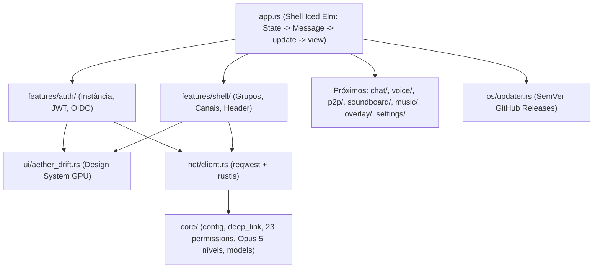

# Arquitetura — Balacopapo Desktop (100% Rust Nativo, Zero WebView)

Cliente desktop nativo de processo único construído com **Rust + `Iced` + `wgpu`**, projetado para **mínima interrupção de CPU/GPU em jogos** (zero queda de 1% low FPS, zero GC pauses, zero `msedgewebview2.exe`).

---

## 1. Zero-Stutter Budget (Metas de Eficiência Real)

Medido somando **toda a árvore de processos do SO**:

| Cenário | Meta RAM Real | Meta CPU / GPU em Jogos |
| :--- | :---: | :--- |
| Em call minimizado na bandeja | **~25–45 MB** | **< 0.5% CPU**, **0% GPU** (0 draw calls) |
| Janela aberta (Chat + Grupos + Mini-Player) | **~60–95 MB** | **0% GPU quando parada** (renderização sob demanda) |
| Assistindo / transmitindo 1080p60 (Hardware) | **~110–150 MB** | Decodificação/captura em hardware (NVDEC/D3D11VA/VAAPI) |
| Overlay In-Game transparente click-through | **+2–4 MB** | Redesenha só em evento de fala/toast/pointer |

---

## 2. Diagrama Modular

---

## 3. Marcos de Evolução

- [x] **Marco 1 — Fundação 100% Nativa (`Iced` + `wgpu`):** Design System Aether Drift, Auth JWT + OIDC (`balacopapo://`), 23 `PermissionBits`, política Opus 5 níveis, SemVer Updater, script guardião `check-desktop-parity.mjs`, CI + Release Windows/Linux.
- [ ] **Marco 2 — Grupos, Pastas & Chat Virtualizado:** WebSocket em tempo real, Markdown, Stickers WebP, uploads `tus`, busca server-side e retenção em 4 níveis.
- [ ] **Marco 3 — Motor de Voz Nível Mumble + Soundboard:** `cpal` (WASAPI/PipeWire) + `nnnoiseless` (RNNoise) + `audiopus` + `livekit`, loopback de mic, Jitter Buffer 0–2000ms e Editor WAV em Canvas GPU.
- [ ] **Marco 4 — Vídeo Zero-Copy GPU + WASAPI Process Loopback:** DXGI/PipeWire 60fps, áudio isolado só da janela, Zoom/Pan 1x–6x e Apontar na Stream.
- [ ] **Marco 5 — Malha P2P Híbrida (Fase 2A/2B/2C):** Arquivos P2P em DMs, Grafo de Latência GPU e Voz P2P com Modo Sobrevivência.
- [ ] **Marco 6 — Overlay In-Game (+2 MB), Atalhos Globais & Presença de Jogos.**
- [ ] **Marco 7 — DMs, Grupos Diretos, Amigos, Mini-Player de Música & Painéis Admin.**
- [ ] **Marco 8 — Controle Remoto Seguro (`Ctrl+Alt+Esc`), Temas, 6 Idiomas & Convergência opcional do Utilidades.**
