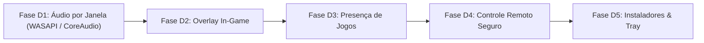

# Roadmap — Balacopapo Desktop (App Nativo)

Este documento descreve a evolução técnica do aplicativo nativo **Balacopapo Desktop** (`packages/desktop`), focado em recursos que dependem de integração direta com o sistema operacional (Windows, Linux e macOS) e que não são possíveis ou ficam limitados no navegador/PWA.

---

## Já Implementado no Desktop
- [x] **Base Electron multiplataforma** (Windows, Linux e macOS) com bandeja do sistema, persistência de janela, tela de seleção de instância e modo de recuperação.
- [x] **Deep links `balacopapo://` (e `backspace://`)** registrados para abrir convites, canais e handoffs no app.
- [x] **Atalhos globais dentro de jogos (sem Alt+Tab)** via `uIOhook` (Windows/macOS/X11) e `GlobalShortcuts` Portal (Wayland): *Mute*, *Deafen*, *Push-to-Talk*, *Câmera*, *Compartilhar Tela*, *Silenciar Soundboard* e **atalhos individuais para qualquer som do Soundboard**.
- [x] **Áudio isolado por aplicativo no Linux (PipeWire)** via `packages/desktop/src/systemAudio.ts` (`buildIncludeNodes` com fallback automático para áudio do sistema).
- [x] **Sistema isolado de Sobreposição no SO (`packages/desktop/src/overlay/OverlayManager.ts`)**: janela transparente click-through dedicada com 3 camadas independentes (`#layer-pointers`, `#layer-speakers` e `#layer-toasts`), já alimentando o sistema de **Apontar na tela** diretamente sobre o monitor compartilhado e pronta para receber os indicadores de fala e avisos da Fase D2.

---

## Fase D1 — Áudio Separado por Janela / Processo (Windows & macOS)
> *Objetivo:* ao compartilhar uma janela específica (jogo, navegador, player), transmitir **apenas o áudio daquele aplicativo** sem vazar música de fundo, notificações do Windows ou a própria call do Balacopapo.

- [ ] **Addon nativo Windows (WASAPI Process Loopback — Rust `napi-rs` ou C++ N-API):**
  - Usar `ActivateAudioInterfaceAsync` com `AUDIOCLIENT_PROCESS_LOOPBACK_PARAMS` (`PROCESS_LOOPBACK_MODE_INCLUDE_TARGET_PROCESS_TREE`) no Windows 10 build 20348+ / Windows 11.
  - Resolver `HWND → PID` diretamente a partir do `source.id` (`window:<hwnd>:0`) selecionado no `ScreenShareSetup`, incluindo sub-processos da mesma árvore (ex.: jogos com launcher, Electron/Chromium).
  - Modo `EXCLUDE_TARGET_PROCESS_TREE` (excluindo o PID do próprio Balacopapo) quando o usuário escolher **Áudio do sistema inteiro**, eliminando eco da call mesmo fora do Chromium.
  - Entregar frames PCM 48 kHz estéreo ao renderer via ring buffer / IPC → `AudioWorkletNode` → `MediaStreamAudioDestinationNode` → track de áudio do LiveKit.
  - Fallback automático para `audio: 'loopback'` padrão em versões antigas do Windows sem suporte a Process Loopback.
- [ ] **macOS 14.2+ (CoreAudio Process Tap / ScreenCaptureKit):**
  - Isolar o áudio do processo/bundle da janela selecionada usando `CATapDescription` / ScreenCaptureKit, excluindo o próprio Balacopapo.
- [ ] **Linux (PipeWire) — refinamento:**
  - Melhorar matching de nome de aplicativo / PID quando o título da janela muda dinamicamente (ex.: abas de navegador ou jogos via Wine/Proton).

---

## Fase D2 — Sobreposição (Overlay In-Game)
> *Objetivo:* ver quem está falando e quem entrou na call sem precisar dar Alt+Tab.

- [ ] **Janela de Overlay transparente e click-through:**
  - `BrowserWindow` dedicada (`transparent: true`, `frame: false`, `alwaysOnTop`, `focusable: false`, `setIgnoreMouseEvents(true)`), funcionando de imediato em jogos em modo *Janela* e *Borderless Fullscreen*.
  - Investigação de hook gráfico (DirectX 11/12 / Vulkan / OpenGL) para suporte futuro a *Fullscreen Exclusivo* no Windows.
- [ ] **Indicador de voz ao vivo:**
  - Lista compacta flutuante com avatar e destaque visual de quem está falando no momento, além de ícones discretos para microfone mutado / áudio ensurdecido.
- [ ] **Avisos discretos (Toasts no Overlay):**
  - Notificação rápida quando alguém entra ou sai da call atual ou dispara um som no Soundboard.
- [ ] **Configurações do Overlay:**
  - Posição nos 4 cantos da tela, opacidade, escala/tamanho, modo compacto (mostrar só quem está falando) e atalho global para ocultar/mostrar o overlay.

---

## Fase D3 — Presença de Jogo e Atividade Nativa
- [ ] **Detecção automática de jogos e apps em execução** (Windows/Linux/macOS) com baixo custo de CPU/memória, integrada ao sistema de presença do servidor (alinhado ao PR upstream `TheZwiss/backspace#482`).
- [ ] **Controles de privacidade:**
  - Ativar/desativar exibição global de atividade.
  - Lista de aplicativos ignorados e opção de definir/sobrescrever o jogo manualmente.

---

## Fase D4 — Controle Remoto Seguro (Controlar Outro PC)
> *Objetivo:* permitir ajudar um amigo ou controlar outro PC durante uma transmissão de tela, com segurança rígida.

- [ ] **Protocolo de sessão sobre DataChannel:**
  - Fluxo de solicitação → **consentimento explícito do dono da tela** antes de aceitar qualquer evento de mouse ou teclado.
  - Mapeamento preciso de coordenadas normalizadas `[0..1]` para a janela ou monitor compartilhado.
- [ ] **Injeção nativa de entrada:**
  - Windows (`SendInput`), Linux (`xdg-desktop-portal` RemoteDesktop / `uinput`) e macOS (`CGEvent`).
- [ ] **Proteções obrigatórias:**
  - Borda visual destacada na tela controlada indicando quem está no controle.
  - **Botão e atalho de pânico local** (ex.: `Ctrl + Alt + Esc`) que revoga o controle instantaneamente a qualquer momento, mesmo se o mouse remoto estiver se movendo.

---

## Fase D5 — Polimento Nativo, Instaladores e Performance
- [ ] **Empacotamento e auto-update via GitHub Releases:**
  - Builds automatizados para Windows (`NSIS` / portátil), Linux (`AppImage`, `.deb`, `Flatpak`) e macOS (`.dmg`), com registro automático do protocolo `balacopapo://`.
- [ ] **Menu rápido na bandeja (System Tray):**
  - Alternar *Mutar*, *Ensurdecer*, *Desconectar da call*, mudar *Status* e opção *Iniciar minimizado com o sistema*.
- [ ] **Economia de recursos em segundo plano:**
  - Reduzir uso de RAM/CPU quando minimizado na bandeja durante jogos pesados (pausar animações, thumbnails e timers não essenciais).

---

## Ordem Sugerida

